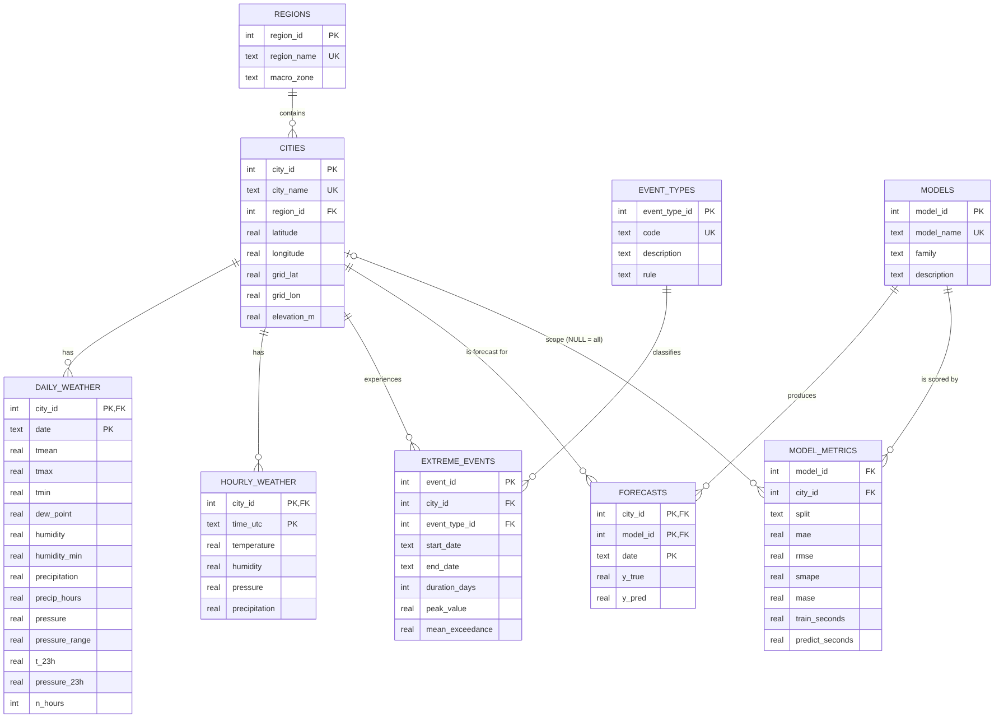

# Climate and Weather of Kazakhstan Cities

Итоговый проект по дисциплине «Programming for Data Analysis and Database», тема №57 (кластер 10, Forecasting & Open Data Analytics).
Команда AAI-2604M: Alana Mukanova, Arailym Kairanbay, Mukhamediyar Amanzhol.

Мы анализируем температурные тренды, экстремумы, волны жары и холода в 13 городах Казахстана по часовым данным ERA5 за 1940–2026 годы и прогнозируем среднюю температуру на следующий день. Лучшая модель на тестовом периоде ошибается в среднем на 1,39 °C, persistence-бейзлайн на 2,22 °C (−37 %).

## Ключевые результаты

| Что | Результат |
| --- | --- |
| Данные | 9 897 576 часовых записей, 13 городов, 1940-01-01 … 2026-11-07, 417 МБ CSV → 110 МБ Parquet |
| Потепление 1940–2025 | +0,23 °C за десятилетие (среднее по 13 городам; от +0,15 в Алматы до +0,30 в Уральске) |
| Потепление 1976–2025 | +0,40 °C за десятилетие (от +0,24 в Алматы до +0,56 в Шымкенте), p < 0,01 во всех городах |
| Самый быстро теплеющий сезон | весна (MAM): +0,45…+0,89 °C за десятилетие |
| 2020–2025 против 1961–1990 | теплее на +1,4…+2,4 °C |
| Волны жары | 1960–70-е: ~520 событий за десятилетие (13 городов); 2020-е: ~1 420 (в пересчёте на 10 лет) |
| Волны холода | 1950–70-е: 650–730 за десятилетие; 2020-е: ~290 |
| Прогноз на завтра (тест 2021–2026) | HistGB + spatial MAE 1,39 °C · HistGB 1,50 · Ridge 1,66 · ARIMA 2,07 · Persistence 2,22 |

## Структура проекта

```
kz-climate/
├── main.py                  # консольное меню + запуск всего пайплайна (--all)
├── config.py                # города, переменные, пути, периоды, параметры
├── requirements.txt
├── src/
│   ├── downloader.py        # загрузка Open-Meteo (requests, повторы, возобновление)
│   ├── preprocessing.py     # CSV → Parquet (chunksize), типы данных, аудит качества, суточные агрегаты
│   ├── database.py          # схема SQLite, загрузка таблиц
│   ├── sql_queries.py       # 12 аналитических SQL-запросов
│   ├── analysis.py          # EDA, тренды, климатические индексы, волны жары/холода, STL, ADF/KPSS, корреляции
│   ├── forecasting.py       # baselines, ARIMA, Ridge, HistGradientBoosting, метрики, error analysis
│   ├── benchmarks.py        # CSV vs Parquet, pandas vs SQL: время, память, совпадение результатов
│   ├── visualization.py     # 12 статичных графиков (matplotlib) + 3 интерактивных (Plotly)
│   ├── pipeline.py          # шаги пайплайна для меню и --all
│   └── utils.py             # замер времени/памяти, JSON
├── dashboard/app.py         # Streamlit-дашборд (фильтры: регион, город, годы, переменная)
├── data/
│   ├── raw/                 # сырые CSV из API (не в репозитории, создаются шагом 1)
│   ├── processed/hourly/    # часовые данные, Parquet, по городам (city=…/part-0.parquet)
│   ├── processed/daily.parquet
│   └── kz_climate.db        # SQLite (создаётся шагом 5)
├── models/                  # обученная модель (joblib)
├── reports/figures/         # графики PNG и HTML
├── reports/tables/          # все таблицы результатов (CSV/JSON)
└── docs/                    # ER-диаграмма, скриншоты дашборда
```

## Как запустить

Нужен Python 3.10 или новее.

```bash
pip install -r requirements.txt

# весь анализ на уже скачанных данных (data/processed), ~8–10 минут
python main.py --all --skip-download

# интерактивное меню
python main.py

# дашборд
streamlit run dashboard/app.py
```

`--no-tune` пропускает подбор гиперпараметров (быстрее на ~4 минуты).

### Загрузка данных заново

Пункт меню 1 (или `python main.py --all` без `--skip-download`) скачивает данные с Open-Meteo. У бесплатного API лимит 10 000 «взвешенных» запросов в день, вес запроса = `nDays/14 × nVariables/10`. Полный набор (13 городов × 87 лет × 4 переменные) весит около 11 800, то есть два дня квоты. Загрузчик это учитывает: при исчерпании дневного лимита он останавливается и при следующем запуске продолжает с того места, где остановился. Если сырых CSV нет (их нет в репозитории), шаг 2 пропускается и пайплайн работает с готовыми Parquet-файлами из `data/processed`.

Источник данных: [Open-Meteo Historical Weather API](https://open-meteo.com/en/docs/historical-weather-api), модель ERA5 (`models=era5`), лицензия CC BY 4.0.

## Меню

```
 1 - Download hourly data from Open-Meteo (resumable)
 2 - Preprocess: CSV -> Parquet, dtype optimisation, quality audit, daily table
 3 - Climate analysis + figures
 4 - Forecasting: baselines vs ARIMA vs Ridge vs gradient boosting
 5 - Load everything into SQLite
 6 - Run the 12 analytical SQL queries
 7 - Benchmarks: CSV vs Parquet, pandas vs SQL
 8 - City climate card: look up one city and year
 9 - Forecast tomorrow's temperature for every city
10 - Run the full pipeline (steps 2-7)
 0 - Exit
```

## Как выполнены требования

| № | Требование | Где в коде |
| --- | --- | --- |
| 1 | ≥ 5 функций | 133 функции (`main.py`, 10 модулей `src/`, дашборд) |
| 2 | list, dict | `config.CITIES` (dict городов), `QUERIES` (dict SQL), `MODEL_INFO`, списки переменных и признаков |
| 3 | if/elif/else | меню, валидация ввода, правила очистки, вердикт ADF/KPSS |
| 4 | for/while | цикл меню `while True`, цикл по чанкам CSV и десятилетиям загрузки |
| 5 | файлы | CSV, Parquet, JSON (`download_state.json`, `run_summary.json`), joblib |
| 6 | try/except | ввод в меню (`ValueError`), отсутствие файла (`FileNotFoundError`), сеть (`ConnectionError`, `Timeout`), лимит API |
| 7 | интерфейс | консольное меню `main.py` + Streamlit-дашборд |
| 8 | модульность | 14 файлов `.py`; стандартные библиотеки `pathlib`, `json`, `datetime`, `csv`, `time`, `multiprocessing`, `sqlite3` |
| 9 | сравнение подходов | 8 моделей прогноза (4 бейзлайна); CSV vs Parquet; chunksize vs полная загрузка; pandas vs SQL — качество, время, память |
| 10 | SQL | 9 таблиц, ER-диаграмма `docs/er_diagram.png`, 12 запросов (JOIN, GROUP BY/HAVING, CTE, подзапросы, оконные функции), результаты в pandas |
| 11 | объём | 9,9 млн строк, 417 МБ; `chunksize`, `float32`/`category`, Parquet (zstd) |

## ER-диаграмма



## Прогноз: результаты на тесте (2021-01-01 … 2026-11-07, 27 781 прогноз)

| Модель | MAE, °C | RMSE, °C | MASE | Обучение, с |
| --- | --- | --- | --- | --- |
| HistGB + spatial | 1,390 | 1,885 | 0,61 | 30,4 |
| HistGB | 1,503 | 2,038 | 0,66 | 21,6 |
| Ridge (lags) | 1,664 | 2,230 | 0,73 | 0,7 |
| ARIMA(2,0,1) | 2,073 | 2,830 | 0,90 | 11,3 |
| Persistence | 2,215 | 3,101 | 0,97 | 0 |
| Moving average 3d | 2,900 | 3,914 | 1,26 | 0 |
| Climatology | 4,079 | 5,144 | 1,78 | 0 |
| Seasonal naive | 5,123 | 6,711 | 2,23 | 0 |

Разбиение хронологическое: обучение 1950–2015, валидация 2016–2020 (подбор гиперпараметров через `TimeSeriesSplit` по датам), тест с 2021 года. Климатология для признаков считается только по обучающим годам.

## Ограничения

- ERA5 — реанализ, а не наблюдения станций; ячейка 0,25° (~25 км) сглаживает рельеф (особенно у Алматы).
- До 1950 года в ERA5 мало исходных наблюдений; аномально тёплые 1940-е в Шымкенте и Кызылорде — вероятный артефакт. Поэтому основной тренд считаем за 1976–2025.
- Загружено 4 переменные (лимит API); облачность и ветер не использованы, вместо облачности — суточная амплитуда температуры.
